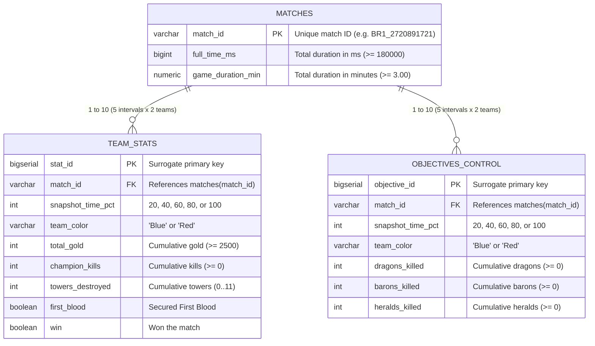

# Phase 3 Technical Summary: Data Cleaning, Relational Modeling & Data Quality

**Course:** Data Engineering and Cloud Computing  
**Project:** League of Legends Ranked Match Telemetry Analysis  
**Phase:** Phase 3 — Data Cleaning, Relational Modeling, PostgreSQL & Data Quality

---

## 1. Key Data Cleaning Decisions & Before/After Row Counts

Our Phase 3 cleaning pipeline (`scripts/clean_and_load.py`) reads the untouched raw dataset (`64,556` matches across `5` interval files = `322,780` raw wide rows) and applies four deterministic cleaning and transformation rules while keeping the `raw` schema (`raw.full_data_20` .. `raw.full_data_100`) completely untouched:

| Cleaning Rule | Issue Addressed | Action Taken | Rows Before | Rows Removed / Modified | Rows After |
| :--- | :--- | :--- | :---: | :---: | :---: |
| **1. Drop Redundant Index (`Unnamed: 0`)** | Leading comma in raw CSV headers created a redundant 0-based column (`0..64555`). | Dropped `Unnamed: 0` column from all 5 snapshots. | 42 cols | 1 col dropped | 41 cols |
| **2. Filter Early Remake Matches (`< 3 min`)** | Matches with `fullTimeMS < 180,000` ms (`< 3.0` minutes) are aborted `/remake` games where players sit at base stats (`2500` gold, `0` kills). | Filtered out rows where `fullTimeMS < 180000`. | 64,556 matches per file (322,780 total rows) | **2,663 matches removed per file** (13,315 total wide rows) | **61,893 clean matches** (309,465 clean wide rows) |
| **3. Fix `FirstBlood` Contradictions** | In 26 non-remake snapshot rows, a team had `ChampionKill > 0` while both `blueFirstBlood` and `redFirstBlood` were `False`. | Imputed `FirstBlood = True` for the team that scored the opening kill(s). | 309,465 clean wide rows | **26 rows imputed in-place** (0 rows dropped) | 309,465 clean wide rows |
| **4. Fix Out-of-Range Tower Counts (`> 11`)** | Summoner's Rift has a physical maximum of 11 towers per team, yet `blueTowerKill` reached up to `18` (`6,682` rows at 100%). | Clipped `blueTowerKill` and `redTowerKill` to `[0, 11]`. | 309,465 clean wide rows | **Capped values `> 11` to `11`** (0 rows dropped) | 309,465 clean wide rows |
| **5. Type Enforcement & Normalization (Wide → 3NF)** | Raw CSVs store Blue and Red team columns side-by-side (`blue*`, `red*`) and omit the snapshot percentage column. | Injected `snapshot_time_pct` (`20, 40, 60, 80, 100`), computed `game_duration_min`, cast types, and unpivoted into 3 normalized tables (`2` team rows per match snapshot). | 309,465 clean wide rows | Unpivoted `1` wide row → `2` team rows (`Blue`, `Red`) | **`matches`: 61,893 rows** **`team_stats`: 618,930 rows** **`objectives_control`: 618,930 rows** |

### Raw vs. Clean Row-Count Reconciliation Formula
- **Raw Matches per Snapshot File:** `64,556` (`322,780` total wide rows across 5 files)
- **Removed `/remake` Matches (`fullTimeMS < 180,000` ms):** `2,663` (`13,315` total wide rows across 5 files)
- **Clean Dimension Table (`public.matches`):** `64,556 - 2,663 = 61,893` unique matches
- **Clean Fact Tables (`public.team_stats` & `public.objectives_control`):** `61,893 matches × 5 snapshots × 2 teams = 618,930` rows each

---

## 2. Relational Database Schema (3NF) & Justification for JOINs

### Entity-Relationship (ER) Diagram

### Schema & JOIN Justification
1. **Eliminating Update & Storage Anomalies (3NF):** In the raw CSVs, match-level metadata (`matchID`, `fullTimeMS`) is duplicated 5 times across the interval files. Moving `full_time_ms` and `game_duration_min` into the dimension table `public.matches` (`match_id` PK) stores match duration once per match (`61,893` rows).
2. **Unpivoting Wide Team Columns (`Blue` / `Red`):** Storing Blue and Red metrics as separate rows identified by `(match_id, snapshot_time_pct, team_color)` with a `UNIQUE` composite constraint allows symmetric aggregation across winning and losing teams without writing messy `CASE WHEN blueWin ... ELSE red...` expressions.
3. **Why Multi-Table `INNER JOIN`s Are Used in Our Analytical Views (`sql/analytical_views.sql`):**
   - **`vw_q1_first_blood_win_rate` (Question 1):** Uses `INNER JOIN` between `public.team_stats` and `public.matches` on `ts.match_id = m.match_id` at `snapshot_time_pct = 100` to calculate win probability with First Blood (`58.05%`) vs. without First Blood (`41.96%`).
   - **`vw_q2_towers_by_match_outcome` (Question 2):** Uses a 3-table `INNER JOIN` across `public.team_stats`, `public.matches`, and `public.objectives_control` on `(match_id, snapshot_time_pct, team_color)` at `snapshot_time_pct = 100` to compare towers destroyed (`7.74` avg / `8.0` median for winners vs. `3.70` avg / `3.0` median for losers) alongside neutral objectives (`dragons`, `barons`, `heralds`).
   - **`vw_q3_gold_growth_across_intervals` (Question 3):** Joins `team_stats`, `matches`, and `objectives_control` across all 5 intervals (`20%, 40%, 60%, 80%, 100%`) to track gold scaling from early game (`8,632` vs. `8,352` gold at 20%) to end game (`61,897` gold for winners vs. `52,928` gold for losers at 100%).
