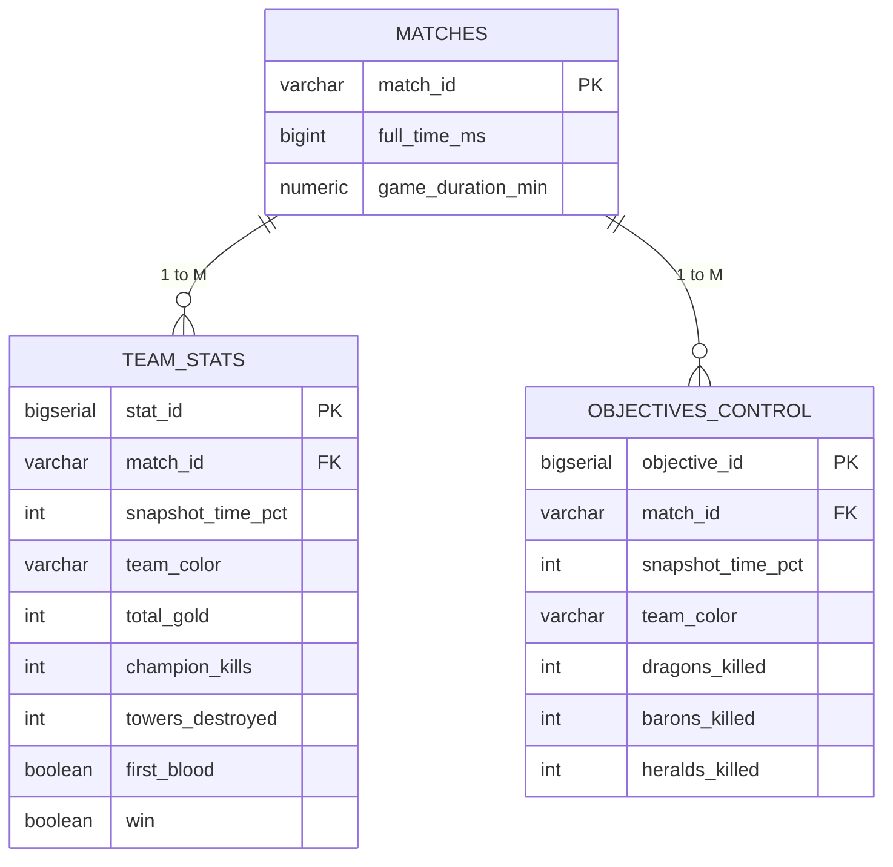

# Project Proposal: League of Legends Match Data Analysis
**Course:** Data Engineering and Cloud Computing  
**Repository:** `Data-Engineering-Gaming-Telemetry-League-of-legends-`  
**Phase:** Phase 1 – Project Proposal & Environment Setup  

---

## 1. Team Members and Roles

| Name | Student ID | Project Role | Core Responsibilities |
| :--- | :--- | :--- | :--- |
| **Mostafa Ashraf Mohamed** | **692300252** | **Project Lead & Infrastructure** | Docker containerization, Git repo coordination, architecture design, setup recording |
| [Student Name 2] | [ID 2] | **Data Ingestion & ETL Engineer** | Dataset extraction, Python cleaning pipeline, data type validation, PostgreSQL loader |
| [Student Name 3] | [ID 3] | **Database Architect & SQL Specialist** | Relational schema design, DDL scripts, constraints, indexes, analytical queries |
| [Student Name 4] | [ID 4] | **Workflow Orchestration (Kestra)** | Pipeline automation, Kestra YAML flow design, task triggers, monitoring |
| [Student Name 5] | [ID 5] | **BI & Data Analytics Engineer** | Connecting visualization tools to PostgreSQL, dashboard development, reporting |

---

## 2. Project Overview and Motivation

League of Legends is a competitive multiplayer online battle arena (MOBA) where strategic decisions, resource management, and objective control determine the match outcome. 

This project designs and implements an end-to-end Data Engineering pipeline to process telemetry data collected across various game intervals. The goal is to ingest, clean, store, orchestrate, and analyze structured match performance metrics to evaluate what factors most strongly correlate with match victory.

---

## 3. Dataset Description

- **Source:** Zenodo open-access research repository
- **Period:** January 12 – May 18, 2023
- **Rank Tiers Covered:** Iron, Bronze, Silver, Gold, Platinum, Diamond
- **Files:** 5 snapshot CSV datasets representing match progress at time intervals:
  - `full_data_20.csv` (Match state at 20% duration)
  - `full_data_40.csv` (Match state at 40% duration)
  - `full_data_60.csv` (Match state at 60% duration)
  - `full_data_80.csv` (Match state at 80% duration)
  - `full_data_100.csv` (Final match state at 100% duration)
- **Dataset Dimensions:**
  - Approximately **16,562 rows** per file
  - **42 columns** per file (covering team metrics for both Blue and Red sides)
  - Total records across all 5 intervals: **~82,810 snapshot observations**

### Key Telemetry Attributes and Data Types

| Attribute Group | Sample Column Names | Raw Type | Target Database Type | Description |
| :--- | :--- | :--- | :--- | :--- |
| **Match Identifiers** | `matchId`, `gameId` | String / Int | `VARCHAR(50)` | Unique match identifier |
| **Duration** | `fullTimeMS`, `gameDuration` | Numeric / Int | `BIGINT` | Total match length in milliseconds |
| **Combat Telemetry** | `kills`, `deaths`, `assists` | Integer | `INT` | Aggregated team combat stats |
| **Economy Telemetry** | `totalGold`, `currentGold` | Integer | `INT` | Accumulated gold at the interval |
| **Structures** | `towersDestroyed`, `inhibitors` | Integer | `INT` | Total defensive structures destroyed |
| **Game Objectives** | `dragons`, `barons`, `heralds` | Integer | `INT` | Neutral epic monsters slain |
| **Match Outcome** | `win`, `firstBlood` | Boolean / Int (0/1) | `BOOLEAN` | First blood event and final win indicator |

---

## 4. Analytical Questions

Our data pipeline will process and model data to directly answer three specific questions:

1. **Analytical Question 1:**  
   *Does securing First Blood significantly increase a team's probability of winning the match?*  
   - **Objective:** Quantify the early momentum advantage of First Blood across different rank tiers.

2. **Analytical Question 2:**  
   *How many towers does a team need to destroy to secure victory?*  
   - **Objective:** Compare average and distribution of towers destroyed between winning and losing teams at the end of the match (100% mark).

3. **Analytical Question 3:**  
   *How does team gold accumulate throughout a match?*  
   - **Objective:** Compare average total gold between early game (20% mark) and final match conclusion (100% mark) to quantify economic scaling.

---

## 5. System Architecture

The pipeline separates data storage/processing from workflow orchestration:

```text
┌────────────────────────────────────────────────────────┐
│               KESTRA (Orchestration Engine)            │
│   - Schedules automated pipeline workflows             │
│   - Triggers Python data ingestion scripts             │
│   - Triggers PostgreSQL SQL transformations & views    │
│   - Pipeline execution monitoring & error alerts       │
└───────────────┬────────────────────────┬───────────────┘
                │ triggers               │ triggers
                ▼                        ▼
  ┌───────────────────┐        ┌───────────────────┐        ┌───────────────────┐
  │   Source Data     │        │    PostgreSQL     │        │    Dashboard /    │
  │   (Zenodo CSVs)   │        │     Database      │        │   Visualization   │
  └─────────┬─────────┘        │ (Docker Container)│        └─────────▲─────────┘
            │                  └─────────▲─────────┘                  │
            │ read                       │ load                       │ query
            ▼                            │                            │
  ┌───────────────────┐                  │                            │
  │ Python Ingestion  │──────────────────┘                            │
  │  (Data Cleaning)  │                                               │
  └───────────────────┘                                               │
            │                                                         │
            └─────────────────────────────────────────────────────────┘
```

### Component Breakdown and Data Movement

1. **Source Layer (Zenodo CSVs):**
   Static snapshot datasets representing match telemetry across 5 defined intervals.
2. **Ingestion & Cleaning Layer (Python):**
   Python scripts utilizing `pandas` to validate headers, convert units, impute missing values, reshape data from wide to long relational format, and write records to PostgreSQL via `SQLAlchemy`.
3. **Database Storage Layer (PostgreSQL & Docker):**
   PostgreSQL 15 database hosted in a container with persistent Docker volumes (`postgres_data`) ensuring data survives container restarts.
4. **Orchestration Layer (Kestra):**
   Coordinates workflow triggers, ensures scripts execute in strict dependency order, and provides centralized log management.
5. **Serving & Analytics Layer (pgAdmin & BI Dashboard):**
   Provides interactive SQL query capabilities via pgAdmin and visual dashboards (Tableau / Power BI / Python) to showcase the analytical findings.

---

## 6. Proposed Database Schema

To prevent data redundancy and support temporal snapshot analysis, data is normalized into 3 relational tables:



### Table 1: `matches` (Match Dimension)
- `match_id` (`VARCHAR(50)`, **PK**): Unique identifier for each match.
- `full_time_ms` (`BIGINT`, **NOT NULL**): Total match duration in milliseconds.
- `game_duration_min` (`NUMERIC(5, 2)`): Duration in minutes for convenient querying.

### Table 2: `team_stats` (Combat & Economy Snapshot Fact Table)
- `stat_id` (`BIGSERIAL`, **PK**): Auto-incrementing identifier.
- `match_id` (`VARCHAR(50)`, **FK**): References `matches(match_id)`.
- `snapshot_time_pct` (`INT`, **NOT NULL**): Interval percentage (`20`, `40`, `60`, `80`, `100`).
- `team_color` (`VARCHAR(10)`, **NOT NULL**): `'Blue'` or `'Red'`.
- `total_gold` (`INT`, **NOT NULL**): Team gold accumulated up to this interval.
- `champion_kills` (`INT`): Total champion kills.
- `towers_destroyed` (`INT`): Total towers destroyed.
- `first_blood` (`BOOLEAN`, **NOT NULL**): Indicates if the team secured First Blood.
- `win` (`BOOLEAN`, **NOT NULL**): Indicates if the team won the match.
- *Constraint:* `UNIQUE(match_id, snapshot_time_pct, team_color)`

### Table 3: `objectives_control` (Objective Telemetry Fact Table)
- `objective_id` (`BIGSERIAL`, **PK**): Auto-incrementing identifier.
- `match_id` (`VARCHAR(50)`, **FK**): References `matches(match_id)`.
- `snapshot_time_pct` (`INT`, **NOT NULL**): Interval percentage (`20`, `40`, `60`, `80`, `100`).
- `team_color` (`VARCHAR(10)`, **NOT NULL**): `'Blue'` or `'Red'`.
- `dragons_killed` (`INT`): Cumulative dragons secured.
- `barons_killed` (`INT`): Cumulative Baron Nashors secured.
- `heralds_killed` (`INT`): Cumulative Rift Heralds secured.
- *Constraint:* `UNIQUE(match_id, snapshot_time_pct, team_color)`

---

## 7. Technology Stack

- **Operating System:** Windows 10/11 with Git Bash
- **Source Control:** Git & GitHub
- **Containerization:** Docker Desktop & Docker Compose
- **Database:** PostgreSQL 15 (Docker)
- **Database Management:** pgAdmin 4 (Docker)
- **ETL Programming:** Python 3.10+, Pandas, SQLAlchemy, Psycopg2
- **Orchestration:** Kestra
- **Visualization:** pgAdmin Query Tool, Tableau / Python (Matplotlib / Seaborn)
